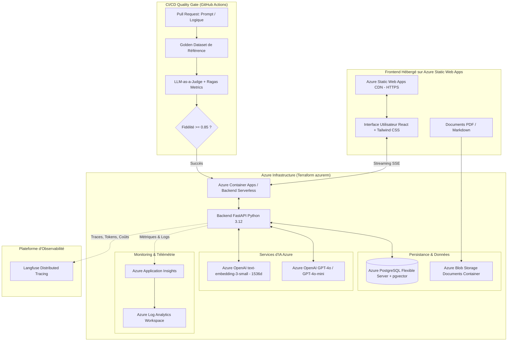

# 🚀 Production LLMOps Platform on Microsoft Azure
### End-to-End Enterprise RAG • Azure OpenAI • Automated CI/CD Evaluation Gate • Distributed Observability

[-0078D4?logo=microsoft-azure)](https://azure.microsoft.com/products/ai-services/openai-service)
[](https://www.terraform.io/)
[](https://github.com/pgvector/pgvector)
[](https://fastapi.tiangolo.com/)
[](https://azure.microsoft.com/products/container-apps)
[](https://react.dev/)
[](https://langfuse.com/)

---

## 🎯 Aperçu du Projet

Cette plateforme regroupe et implémente l'ensemble du cycle de vie d'une application d'**IA Générative en Production (LLMOps)** sur l'écosystème **Microsoft Azure**.

Conçue selon les standards d'ingénierie logicielle les plus stricts, elle fusionne 3 composants critiques :
1. **Pipeline Advanced RAG de Production :** Ingestion documentaire, chunking sémantique récursif, embeddings normalisés via **Azure OpenAI (`text-embedding-3-small`)**, stockage vectoriel avec index **HNSW** sur **Azure Database for PostgreSQL Flexible Server (`pgvector`)**, recherche hybride dense + sparse (BM25) via **Reciprocal Rank Fusion (RRF)**, reranking et génération contextuelle en streaming avec **GPT-4o / GPT-4o-mini** sur **Azure OpenAI Service**.
2. **Quality Gate CI/CD & Évaluation Automatisée :** Banc d'évaluation continue bloquant tout déploiement en cas de régression de qualité (seuil de fidélité anti-hallucination $\ge 0.85$, pertinence $\ge 0.70$) et notation qualitative via **LLM-as-a-Judge**.
3. **Observabilité, Télémétrie & Alerting :** Traçabilité distribuée de bout en bout avec **Langfuse** (latence TTFT, décomposition des temps de recherche, tokens consommés, calcul exact du coût en USD à chaque requête), collecte de feedback utilisateur (+1 / -1) et télémétrie **Azure Application Insights / Log Analytics**.

---

## 🏗️ Architecture Globale sur Microsoft Azure



---

## 💎 Les 3 Piliers LLMOps Détaillés

### Pilier 1 : Advanced RAG avec Hybrid Search & Reranking
- **Ingestion & Chunking :** Découpage récursif avec préservation sémantique de 600 caractères et 100 caractères d'overlap.
- **Indexation vectorielle :** Index HNSW (`vector_cosine_ops`) sur Azure Database for PostgreSQL Flexible Server garantissant des temps de réponse sous les 15 ms.
- **Hybrid Search :** Combine les embeddings vectoriels et la recherche textuelle BM25 via l'algorithme RRF (*Reciprocal Rank Fusion*) :
  $$RRF\_Score(d) = \sum_{m \in \{dense, sparse\}} \frac{w_m}{k + rank_m(d)}$$
- **Garde-fous Anti-Hallucination :** Prompt système strict imposant la citation obligatoire de sources et interdisant toute extrapolation hors contexte.

### Pilier 2 : Automated Evaluation & CI/CD Quality Gate
- **Golden Dataset :** Cas de tests représentatifs avec vérités terrain et mots-clés obligatoires.
- **Métriques quantitatives :**
  - *Faithfulness (Fidélité au contexte)* : Détection automatique des affirmations non prouvées.
  - *Answer Relevancy (Pertinence de la réponse)* : Mesure de l'adéquation à l'intention utilisateur.
  - *Context Precision & Recall* : Vérification de la complétude du retrieval.
- **LLM-as-a-Judge :** GPT-4o évalue chaque réponse selon une grille de 1 à 5 avec verdict structuré JSON.
- **Blocage en CI/CD :** Exécuté sous GitHub Actions. Tout merge est bloqué si la fidélité chute sous le seuil configuré.

### Pilier 3 : Observabilité, Tracing & Détection de Dérive
- **Télémétrie distribuée :** Capture de l'arborescence complète (Query $\rightarrow$ Retrieval $\rightarrow$ Reranking $\rightarrow$ LLM Generation).
- **Calcul de coût en temps réel :** Calcul automatique basé sur les tarifs Azure OpenAI (GPT-4o-mini : \$0.15 / 1M input tokens, \$0.60 / 1M output tokens).
- **Boucle de feedback :** Corrélation directe des votes utilisateurs (+1 / -1) avec l'identifiant de trace dans Langfuse.
- **Monitoring d'Entreprise :** Azure Application Insights pour la télémétrie des requêtes HTTP, temps d'exécution et exceptions.

---

## 🛠️ Stack Technique sur Azure

| Domaine | Technologies |
|---|---|
| **Cloud Provider** | Microsoft Azure |
| **Modèles LLM & Embeddings** | Azure OpenAI Service (`gpt-4o-mini`, `text-embedding-3-small`) |
| **Infrastructure as Code (IaC)** | Terraform v1.8+ (`azurerm` provider, Resource Groups, VNet, PostgreSQL, Blob, Container Apps, App Insights) |
| **Base de Données Vectorielle** | Azure Database for PostgreSQL Flexible Server 16 + extension `pgvector` (HNSW) |
| **Backend & API** | Python 3.12, FastAPI, Pydantic Settings, OpenAI SDK, Azure Storage SDK, Rank-BM25, Uvicorn |
| **Conteneurisation Serverless** | Azure Container Apps (ACA) avec mise à l'échelle automatique (scale-to-zero) |
| **Frontend** | React 18, Vite, TypeScript, Tailwind CSS, hébergé sur Azure Static Web Apps |
| **Observabilité & Tracing** | Langfuse (OpenTelemetry), Azure Application Insights, Log Analytics |
| **CI/CD & Évaluation** | GitHub Actions, RAGAS, DeepEval, Pytest |

---

## 🚀 Démarrage Rapide

### 1. Prérequis
- Python 3.11+
- Node.js 20+
- Docker & Docker Compose
- Compte Azure authentifié (`az login`) avec souscription active
- Terraform v1.5+

### 2. Déploiement de l'Infrastructure avec Terraform
```bash
cd terraform

# Initialiser Terraform et les modules Azure
terraform init

# Vérifier et prévisualiser les ressources Azure
terraform plan

# Déployer l'infrastructure sur votre souscription Azure
terraform apply
```

### 3. Exécuter les Tests & le Quality Gate
```bash
cd backend
PYTHONPATH=. pytest tests
```

---

## 💼 Valorisation sur votre CV / Profil LinkedIn

Voici des points concrets prêts à être intégrés à votre CV :

> **AI / LLMOps Engineer — Architecture RAG & Observabilité Cloud (Azure, OpenAI, Terraform)**
> - *Conception et déploiement d'une plateforme RAG d'entreprise sur Microsoft Azure via Terraform (PostgreSQL Flexible Server avec pgvector, Azure Blob Storage et Azure Container Apps serverless).*
> - *Intégration d'Azure OpenAI Service (GPT-4o et text-embedding-3) avec un moteur de recherche hybride combinant dense vector search (HNSW) et BM25 avec fusion RRF.*
> - *Mise en place d'un Quality Gate CI/CD sous GitHub Actions évaluant automatiquement les régressions de prompts (Faithfulness $\ge 0.85$, Relevancy) à l'aide d'un LLM-as-a-Judge.*
> - *Mise en œuvre d'une observabilité distribuée avec Langfuse et Azure Application Insights : latence p95, calcul dynamique des coûts d'inférence et boucles de feedback utilisateur.*
